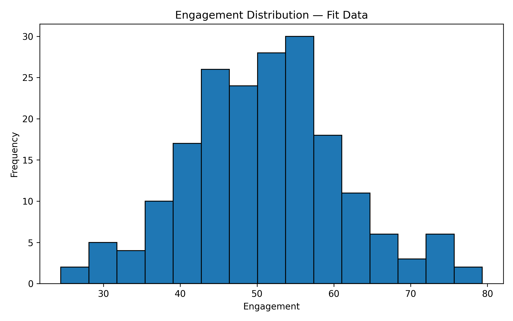
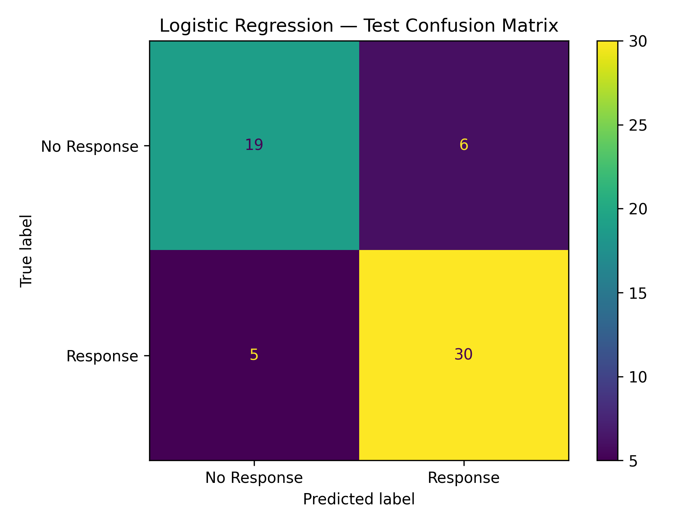
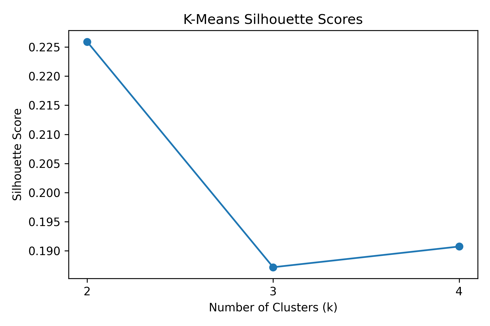
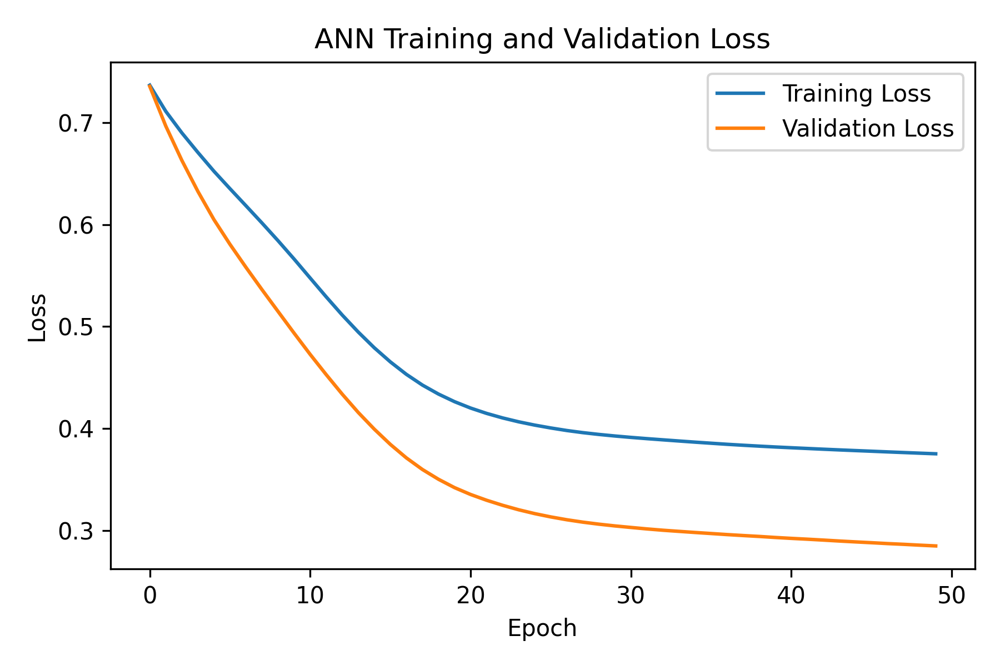

<div align="center">

# 📊 Data Science & AI/ML — Set A
### Campaign Response Prediction & Audience Segmentation

**A practical machine-learning project** covering statistical analysis, data preparation, classification, clustering, and an artificial neural network.


</div>

---

## 🧭 Project Overview

The goal is to **predict whether a person responds to a campaign** and discover groups of records with similar characteristics. The project uses a synthetic dataset and demonstrates a complete, reproducible data-science workflow.

### 🎯 What this project covers

- 📈 **Maths & statistics:** descriptive statistics, Welch's t-test, confidence interval, covariance matrix, and eigenvalues.
- 🧹 **Data preparation:** duplicate removal, missing-value imputation, train/validation/test split, one-hot encoding, and standard scaling.
- 🧪 **Feature engineering:** creates `engineered_feature = engagement / (recency + 1)`.
- 🤖 **Supervised learning:** majority-class baseline and Logistic Regression.
- 🧩 **Unsupervised learning:** K-Means clustering and silhouette-score comparison.
- 🧠 **Deep learning:** a dense ANN with early stopping and validation-loss monitoring.
- 📦 **Reproducibility:** saved metrics, predictions, plots, preprocessing objects, and trained model.

> **Note:** This is a synthetic practice dataset. Results are for learning and evaluation, not evidence of real-world campaign performance.

---

## 🗂️ Repository Structure

```text
set A- practical mock interview/
├── data/
│   └── raw/
│       └── set_d.csv
├── models/
│   ├── ann_model.keras
│   └── preprocessing.joblib
├── Notebook/
│   └── exam.ipynb
├── outputs/
│   ├── figures/
│   │   ├── ann_loss_curve.png
│   │   ├── confusion_matrix.png
│   │   ├── engagement_histogram.png
│   │   └── kmeans_silhouette.png
│   ├── splits.csv
│   ├── statistics_summary.csv
│   ├── inference_results.csv
│   ├── model_metrics.csv
│   ├── final_model_comparison.csv
│   ├── test_predictions.csv
│   ├── ann_test_predictions.csv
│   ├── kmeans_diagnostics.csv
│   ├── cluster_profiles.csv
│   └── ...
├── src/
│   └── generate_data.py
├── requirements.txt
├── .gitignore
└── README.md
```

---

## ⚙️ Setup and Run

### 1. Requirements

Install **Python 3.10 or newer**. TensorFlow support depends on the Python version and operating system; use a compatible Python environment.

### 2. Clone the repository

```bash
git clone <YOUR_PUBLIC_REPOSITORY_URL>
cd "set A- practical mock interview"
```

Replace the placeholder with your own repository URL.

### 3. Create and activate a virtual environment

**Windows PowerShell**
```powershell
python -m venv .venv
.\.venv\Scripts\Activate.ps1
```

**macOS / Linux**
```bash
python3 -m venv .venv
source .venv/bin/activate
```

### 4. Install packages

```bash
python -m pip install --upgrade pip
pip install -r requirements.txt
```

### 5. Generate the dataset (only if needed)

Run this command from the repository root:

```bash
python src/generate_data.py
```

The generator creates `data/raw/set_d.csv`. It intentionally includes **305 rows**, five duplicate rows, and missing values. The cleaned dataset should contain **300 distinct records**. Keep the supplied generator unchanged if following the practical specification.

### 6. Run the notebook

```bash
jupyter notebook
```

Open `Notebook/exam.ipynb` and run the cells from top to bottom. Run it from the expected project layout because the notebook uses relative paths for inputs and outputs.

---

## 🧾 Dataset Guide

The generated data represents campaign-related observations. Numeric values are synthetic index measurements, not physical units.

| Column | Description |
|---|---|
| `record_id` | Unique record identifier; excluded from model features |
| `visits` | Synthetic visits index |
| `recency` | Synthetic recency index |
| `engagement` | Synthetic engagement index |
| `spend` | Synthetic spending index |
| `group` | Categorical cohort (`G1` or `G2`) |
| `response` | Target: `1` = response, `0` = no response |

### 🛠️ Data preparation rules

1. Remove exact duplicates before splitting; do not modify the raw CSV.
2. Split the 300 distinct records into **192 fit**, **48 validation**, and **60 test** records.
3. Use stratified splitting and `random_state=42`.
4. Fit preprocessing only on the 192 fit records; reuse the fitted transformations for validation and test data.
5. Median-impute numeric values, one-hot encode `group`, and standard-scale numeric features.
6. Create `engineered_feature` after numeric imputation and before scaling.
7. Keep the test partition untouched until final evaluation.

These steps help prevent data leakage and make model comparisons fair.

---

## 🧠 Models and Methods

| Method | Purpose | Main configuration |
|---|---|---|
| Dummy Classifier | Baseline comparison | `most_frequent` |
| Logistic Regression | Campaign response classification | `max_iter=1000` |
| K-Means | Audience segmentation | `k=2, 3, 4`, `n_init=10`, seed `42` |
| Dense ANN | Non-linear classification | 16 and 8 ReLU units; sigmoid output |
| ANN training | Learn from fit data and monitor validation | Adam, learning rate `0.001`, batch size `16`, up to 50 epochs, early-stopping patience `5` |

The ANN uses binary cross-entropy because the target is binary and the output layer produces a response probability. The 48 validation records guide early stopping; the final 60 test records are used for final evaluation.

---

## 📊 Visual Results

### 📉 Engagement distribution



### 🎯 Logistic Regression confusion matrix



### 🧩 K-Means silhouette comparison



### 🧠 ANN training and validation loss



---

## 📌 Recorded Results

The following values are taken from the result files currently included in this project. If you rerun the notebook, check the regenerated CSVs before updating these figures.

### 📈 Classification comparison

| Model | Accuracy | Precision | Recall | F1-score |
|---|---:|---:|---:|---:|
| Majority-class baseline | 58.33% | — | — | — |
| Logistic Regression | 81.67% | 83.33% | 85.71% | 84.51% |
| ANN | 86.67% | 90.91% | 85.71% | 88.24% |

On the recorded holdout, the ANN has the higher F1-score. This is a result from one small test split, so it does not prove that the ANN will perform better on new data.

### 🔬 Statistics and clustering

- **Engagement mean:** approximately `51.00`
- **Engagement median:** approximately `51.41`
- **Engagement sample standard deviation:** approximately `10.29`
- **Observed sample size in the saved summary:** `192`
- **Best silhouette score among the saved K-Means runs:** `k = 2`, score approximately `0.226`

The silhouette score is modest, so the clusters should be treated as exploratory segments rather than clearly separated audience types. Cluster IDs are arbitrary and do not represent response classes.

### 💡 Practical interpretation

A campaign team could use the clusters to explore different engagement patterns and design follow-up experiments. Before taking business action, validate the patterns on new data and measure outcomes. These synthetic results do not establish causal effects.

---

## 📁 Outputs and Saved Artifacts

- `outputs/statistics_summary.csv` — descriptive statistics
- `outputs/inference_results.csv` — inference results
- `outputs/splits.csv` — record IDs and partition membership
- `outputs/preprocessing_audit.csv` — preprocessing checks
- `outputs/model_metrics.csv` and `outputs/final_model_comparison.csv` — model evaluation metrics
- `outputs/test_predictions.csv` and `outputs/ann_test_predictions.csv` — test predictions
- `outputs/kmeans_diagnostics.csv` and `outputs/cluster_profiles.csv` — clustering results
- `outputs/figures/` — saved charts
- `models/ann_model.keras` — trained ANN
- `models/preprocessing.joblib` — saved preprocessing objects

---

## ▶️ Video Walkthrough

- **Video URL:** `https://drive.google.com/file/d/1zO3OxVU7_ikVfRHfKECJUKrZk15dAen2/view?usp=sharing`


Make sure the link can be opened by the examiner without requesting access. Do not claim a video is available until the link has been added and tested.

---

## 👤 Student Details

- **Name:** `MAITRAK KUNJADIYA`
- **Student ID:** `10015`
- **Practical Set:** A
- **Repository URL:** `https://github.com/Maitrak-2661/PRACTICAL_EXAM-SET-A-.git`


Update these placeholders before submission.

---

## 📚 References and Declaration

- pandas documentation: https://pandas.pydata.org/docs/
- scikit-learn documentation: https://scikit-learn.org/stable/
- SciPy documentation: https://docs.scipy.org/doc/scipy/
- TensorFlow / Keras documentation: https://www.tensorflow.org/guide/keras

**Declaration:** All work is my own except where external code, sources, or references are cited.

---

<div align="center">

### 🚀 Learn • Build • Evaluate • Improve

*Reproducibility and clear interpretation matter as much as model scores.*

</div>
